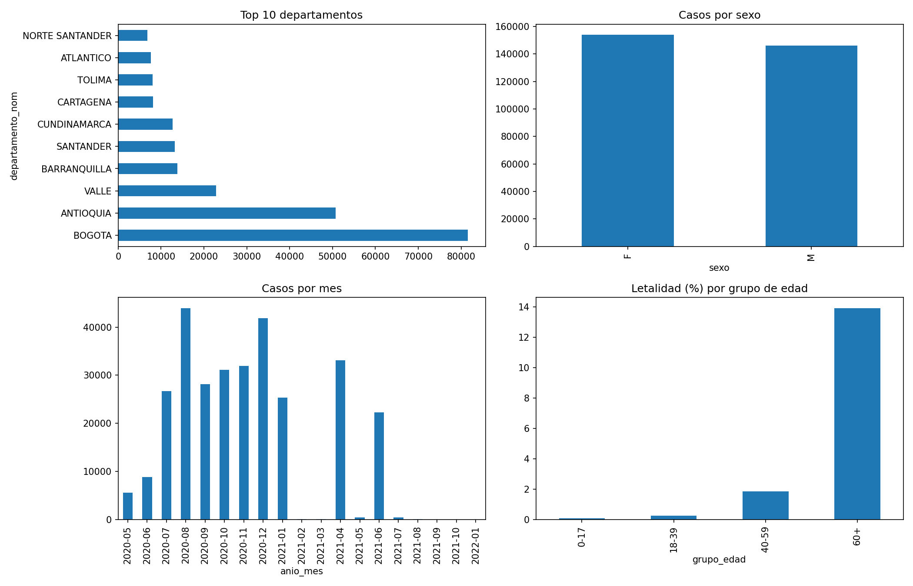

# Análisis batch de casos de COVID-19 en Colombia con Apache Spark trabajo de la Tarea 3 del curso Big Data (UNAD, código 202016911).

## pregunta problema
¿Cómo se distribuyeron los casos de COVID-19 en Colombia por departamento, edad y sexo, y qué grupos de edad tuvieron mayor letalidad?

## Dataset
"Casos positivos de COVID-19 en Colombia", publicado por el Instituto Nacional de Salud en datos.gov.co (id `gt2j-8ykr`).
Se usó una muestra de 300.000 registros, descargada de: https://www.datos.gov.co/resource/gt2j-8ykr.csv?$limit=300000

## Entorno de desarollo utilizado
- Ubuntu 22.04 en VirtualBox (VM con Hadoop y Spark de actividad 2)
- Apache Spark 3.5.8, Python 3.10
- Librerías: `matplotlib` y `pandas` (`pip install matplotlib pandas`)

##como ejecutar el proyecto
Con `covid_colombia.csv` en la misma carpeta el comando: spark-submit batch_covid.py

Este comando Imprime las tablas en consola y genera la imagen `resultados_batch.png`

## Qué hace el script
1. Carga el CSV con DataFrames de Spark y muestra el esquema.
2. Limpieza y transformación:** elimina duplicados, normaliza `sexo` y `recuperado` (el dato traía `Fallecido` y `fallecido`), convierte la edad a años usando `unidad_medida`, descarta edades fuera de 0-110, convierte fechas y crea el grupo de edad, el mes y la variable `fallecido`.
3. EDA casos por departamento, sexo y mes, y letalidad por grupo de edad.
4. Visualización cuatro gráficas en el archivo `resultados_batch.png`.

## Resultados encontrados
- 300.000 registros cargados, no se eliminó ninguna fila al limpiar.
- Bogotá (81.600) y Antioquia (50.753) concentran más casos, Valle es tercero (22.871).
- Por sexo: 153.861 mujeres y 146.139 hombres
- Fallecidos en la muestra: 8.408
- Letalidad por grupo de edad: 0-17 años, 0,09 %; 18-39, 0,25 %; 40-59, 1,85 %; 60 o más, 13,93 %.

## Limitaciones encontradas
- Es una muestra de 300.000 registros sin orden cronológico: el conteo por mes tiene huecos y no representa la evolución real de la pandemia.
- La letalidad es la de la muestra, no la tasa nacional.
- Barranquilla y Cartagena aparecen separadas de Atlántico y Bolívar porque así las registra el INS.

## Autor
Cristian Yesid Correa Aullón
